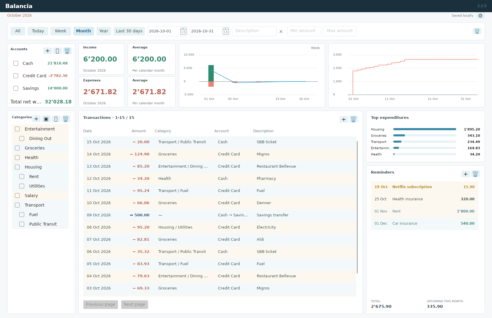

# Balancia

A personal finance ledger for Windows, with a read-only Android companion. Record income, expenses, and transfers across local accounts; browse and filter history; watch account balances, spending trends, and upcoming reminders — all from one local SQLite ledger, with no server and no subscription.

   

## What it does

1. Records expenses, income, and transfers against local accounts, with dated opening balances and up to two levels of categories.
2. Shows net worth, income/expense trends, and a cumulative timeline for whatever period and filters are currently selected — day, week, month, year, or a custom range.
3. Tracks reminders for repeating payments (rent, subscriptions, insurance) by description and due month, surfacing overdue and upcoming occurrences without ever creating a transaction automatically. A payment satisfies a reminder when its description matches exactly (surrounding spaces ignored) in the due month.
4. Imports the owner's existing CSV export (matching transfers, opening balances, categories, and reminder templates) and exports the ledger back to CSV at any time.
5. Backs up and restores consistent local snapshots, and hands a read-only, validated copy to the Android companion for balance and history lookups on the go.

The Windows desktop is the only writer; Android never opens or synchronizes the live database. See [docs/Technical_Design_Description.md](docs/Technical_Design_Description.md) for how that boundary — and the rest of the design — works.

## UI overview

Everything lives on one Overview dashboard: a filter row (period presets, custom dates, description, and amount range) drives every card and chart below it.



- **Accounts** — balances per account, with checkboxes that feed the same filter as every other card, and total net worth below the list.
- **Income / Expenses / Average** — totals for the selected period, plus per-calendar-unit averages that account for periods with no activity.
- **Trend / Timeline** — a bar/line chart of income, expenses, and savings by day, week, or month, and a cumulative comparison against the immediately preceding period of equal length.
- **Categories** — checkbox filtering with parent/child rollup, shared with the **Top expenditures** card on the right.
- **Transaction history** — a paged, searchable, double-click-to-edit table combining every filter above, with rows shaded by day.
- **Reminders** — upcoming and overdue repeating payments, with a total for everything shown and a subtotal for the current month, or for the next month once nothing is left in the current one. Rows are coloured by urgency and shaded by month.

A gear icon opens **Settings** for the database/backup/snapshot folder pickers, CSV import/export, snapshot export/restore, the English/German/Russian/Ukrainian language picker, and a theme picker. The picker lists the built-in `Balancia` theme and the `*.json` theme files in a `themes` folder beside `settings.json`; a theme file has an optional `name` and a `colors` object that maps color role names (the fields of `src/Balancia.Desktop/Palette.cs`) to `#RRGGBB` or `#AARRGGBB` values, and any role it leaves out keeps its built-in color.

## Tech stack

The `Text` theme role also controls account and category names, net-worth labels, top-expenditure labels and values, and filter checkbox outlines and marks. Dialogs and Fluent controls share the palette, including their popup and interaction states.

- **.NET 10 / Avalonia** — Windows desktop UI, with a native .NET Android viewer sharing the ledger code
- **SQLite** (`Microsoft.Data.Sqlite`) — local relational storage, no server, no ORM
- **xUnit** — unit, SQLite integration and headless Avalonia UI test suite

## Project structure

| Project                                                     | Purpose                                                                                |
|:----------------------------------------------------------- |:-------------------------------------------------------------------------------------- |
| `src/Balancia.Core`                                         | Domain rules and application operations; no Avalonia, SQLite, or platform dependencies |
| `src/Balancia.Storage`                                      | SQLite schema, queries, CSV import/export, and snapshot storage                        |
| `src/Balancia.Desktop`                                      | The Avalonia Windows application (full read/write UI)                                  |
| `src/Balancia.Android`                                      | The read-only native Android shell                                                     |
| `tests/Balancia.Core.Tests`, `tests/Balancia.Storage.Tests` | Unit and SQLite integration tests                                                      |
| `tests/Balancia.Desktop.Tests`                              | Headless UI tests that open the real `MainWindow` against a temporary data folder      |

## Documentation

Windows diagnostics are in `%LOCALAPPDATA%\Balancia\log\balancia-yyyyMMdd.log`. Android diagnostics are in app-private `NoBackupFilesDir/log`.

- [`docs/Technical_Design_Description.md`](docs/Technical_Design_Description.md) — architecture, context diagrams, and design decisions; the primary entry point for the project
- [`docs/PLAN.md`](docs/PLAN.md) — remaining/upcoming tasks
- Follow the coding guidelines defined by the common harness.
- [`AGENTS.md`](AGENTS.md) / [`MEMORY.md`](MEMORY.md) — entry point and working handoff for AI agents and contributors

## Getting started

All projects target `net10.0` except `Balancia.Android`, which targets `net10.0-android` and needs the .NET Android workload to build. Direct package versions are pinned in project files, `packages.lock.json` locks the transitive graph, and `nuget.config` restores from nuget.org only.

```powershell
dotnet restore Balancia.slnx --locked-mode
dotnet build Balancia.slnx -c Release --no-restore
dotnet test Balancia.slnx -c Release --no-build --no-restore
dotnet run --project src/Balancia.Desktop -c Release --no-build --no-restore
```

`tests/Balancia.Desktop.Tests` runs on Avalonia's headless platform (xUnit v3), so it needs no display and never touches `%LOCALAPPDATA%\Balancia`: each test gets its own temporary data folder and settings file. Tests that need Windows DPAPI skip themselves elsewhere.

Measure line coverage with the collector that each test project references (reports land in the ignored `artifacts` folder):

```powershell
dotnet test Balancia.slnx -c Release --no-build --no-restore --collect:"XPlat Code Coverage" --results-directory artifacts/coverage
```

Set `BALANCIA_PERF=1` to run the 50,000-transaction latency test, which fails when a read exceeds a 200 ms p95 budget.

For a separate test dataset, pass `--data-dir C:\absolute\directory` after `--` in the `dotnet run` command — the app creates that directory and its schema on first run.

The app stores its working database at `%LOCALAPPDATA%\Balancia\balancia.db` by default. CSV import accepts only Balancia's own export format: `ID,Date,Type,Description,Amount,Account,DestinationAccount,Category,Memo`, with `YYYY-MM-DD` dates. Open Settings, choose **Import CSV**, inspect the preview, and apply it. An import replaces the whole ledger: accounts, categories, transactions and reminders are deleted first (the preview says how many), after a recovery copy of the old database is saved next to it, so the file becomes the ledger. **Export CSV** writes the current ledger, including explicit opening balances and one row per transfer.

## Private data

Snapshots and rolling backups are encrypted. In Settings, choose **Set passphrase** under **Snapshot encryption** (minimum 12 characters, entered twice). Windows remembers the key using current-user DPAPI and encrypts manual exports and both close-time destinations automatically. On Android, import the new snapshot and enter the same passphrase once; Android Keystore protects the remembered key for later imports.

Keep the passphrase separately for a new/reinstalled device. Changing it affects future exports; older files still need their original phrase. The working databases, local `.bak` recovery copies, and CSV exports remain plaintext.

Committed tests use only synthetic fixtures. For a one-off reconciliation test against a real export, set `BALANCIA_PRIVATE_IMPORT_PATH` to its absolute path before running the test command, then unset it.