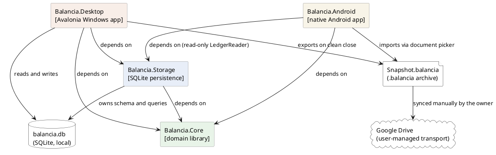
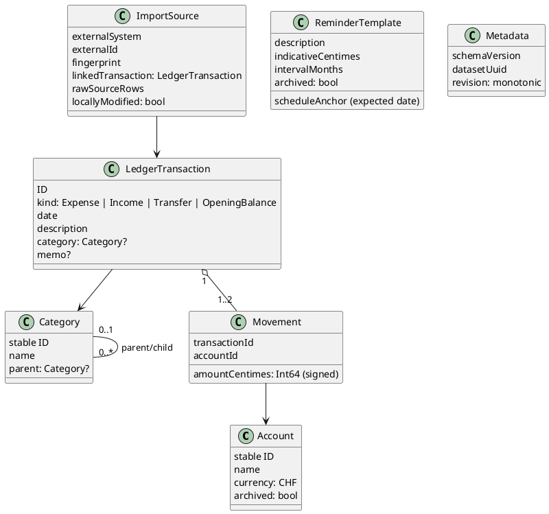
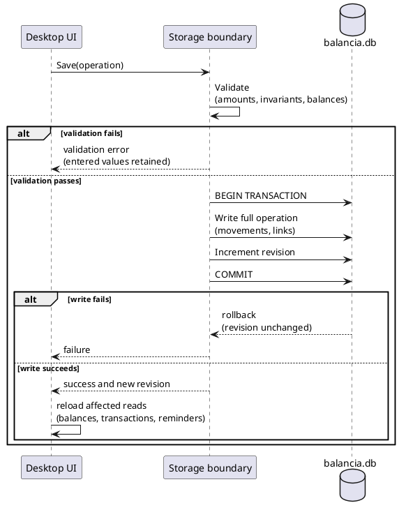
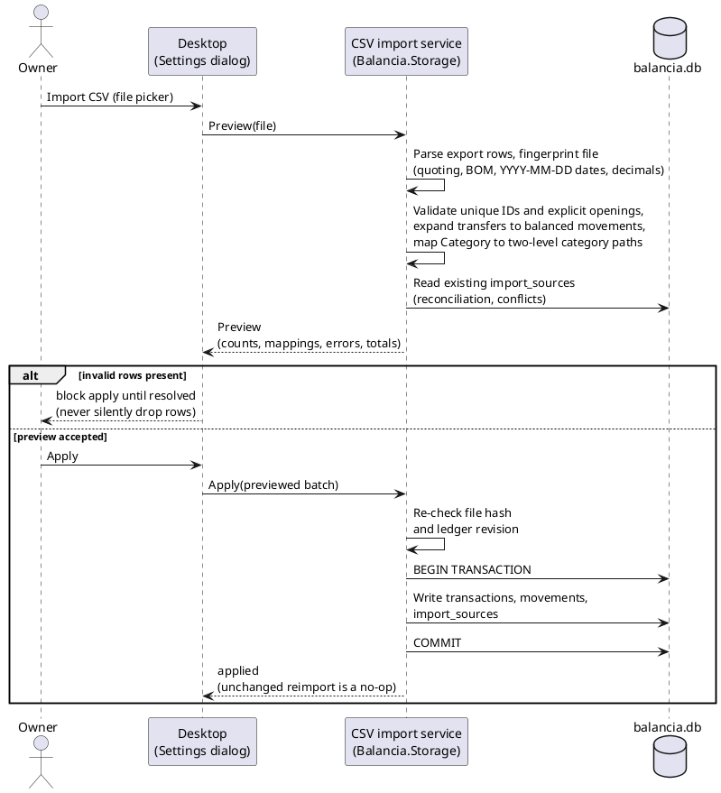
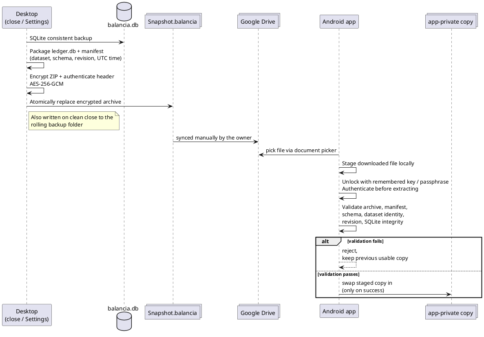

# Technical Design Description - Balancia <!-- omit from toc -->

---

**Author:** `Viacheslav Shyshkin [Developer]`
**Guideline Version:** `1.2`

**Modification History:**

- **V1.0:** by shyshkiv `28-Sep-2026`: **Initial version**.
- **V1.1:** `02-Oct-2026`: **Consolidated desktop settings persistence**.
- **V1.2:** `03-Oct-2026`: **Encrypted snapshots and backups, protected device keys**.
- **V1.3:** `15-Oct-2026`: **Removed schema migrations and plaintext snapshot support**.
- **V1.4:** `16-Oct-2026`: **Read-only viewer boundary, extracted desktop services, exact reminder matching, stale viewer import rule, test strategy**.

## Table of Contents <!-- omit from toc -->

- [Purpose](#purpose)
- [Scope](#scope)
- [References](#references)
- [Abbreviations and Definitions](#abbreviations-and-definitions)
- [Unit Safety Classification](#unit-safety-classification)
- [Unit Design Notes / Decisions](#unit-design-notes--decisions)
- [Overview](#overview)
  - [Considerations for a Secure Design](#considerations-for-a-secure-design)
  - [Considerations for Localization](#considerations-for-localization)
  - [Context Map](#context-map)
- [Core Context (Balancia.Core)](#core-context-balanciacore)
  - [Domain Model](#domain-model)
  - [Money and Transfer Invariants](#money-and-transfer-invariants)
- [Storage Context (Balancia.Storage)](#storage-context-balanciastorage)
  - [Schema and Version Check](#schema-and-version-check)
  - [Ledger Write Lifecycle](#ledger-write-lifecycle)
  - [Read Queries and Indexing](#read-queries-and-indexing)
  - [CSV Import and Export](#csv-import-and-export)
  - [Reminders](#reminders)
  - [Snapshot Export, Validation, and Restore](#snapshot-export-validation-and-restore)
- [Desktop Context (Balancia.Desktop)](#desktop-context-balanciadesktop)
  - [Window Composition](#window-composition)
  - [Transaction category suggestions](#transaction-category-suggestions)
  - [Transaction description suggestions](#transaction-description-suggestions)
  - [Localization](#localization)
  - [Application logging](#application-logging)
  - [Local Settings Persistence](#local-settings-persistence)
- [Android Context (Balancia.Android)](#android-context-balanciaandroid)
- [Testing](#testing)
- [Non-Functional Considerations](#non-functional-considerations)
- [Open Choices](#open-choices)

---

## Purpose

This document outlines the design of **Balancia** — a personal finance ledger. Windows provides full management of accounts, transactions, categories, and reminders; a companion Android app provides read-only balances and history search from a manually transported snapshot.

The intended audience for this document is developers and AI agents implementing or reviewing Balancia, and anyone assessing the overall design approach before making a change.

While this document provides a high-level design overview, for detailed implementation information please consult the source code directly. This document is intended to become the primary entry point for the project.

## Scope

This TDD covers all projects in the `Balancia.slnx` solution:

- **Balancia.Core** — domain rules and application operations, free of Avalonia, SQLite, file-picker, and cloud dependencies
- **Balancia.Storage** — SQLite schema, queries, CSV import/export, and snapshot storage
- **Balancia.Desktop** — the Avalonia Windows application (full read/write UI)
- **Balancia.Android** — a read-only native Android shell
- **Balancia.Core.Tests** / **Balancia.Storage.Tests** / **Balancia.Desktop.Tests** — the automated test suites

It describes the architectural decisions, the context boundaries, and the key workflows of each context.

## References

| Reference | Title                                                                           |
|:--------- |:------------------------------------------------------------------------------- |
| 1         | [docs/PLAN.md](PLAN.md) — remaining/upcoming tasks                             |
| 2         | [AGENTS.md](../AGENTS.md) — agent/contributor operational entry point           |

## Abbreviations and Definitions

| Abbreviation | Description                                                                                       |
|:------------ |:------------------------------------------------------------------------------------------------- |
| TDD          | Technical Design Description                                                                      |
| CSV          | Comma-Separated Values                                                                            |
| UI culture   | The .NET `CultureInfo` explicitly selected for display, independent of the ambient thread culture |

## Unit Design Notes / Decisions

| Design Decision                                            | Justification                                                                                                                                            | Architectural Constraint                                                                                                                                             |
|:---------------------------------------------------------- |:-------------------------------------------------------------------------------------------------------------------------------------------------------- |:-------------------------------------------------------------------------------------------------------------------------------------------------------------------- |
| **Local Windows writer, read-only Android**                | Matches actual single-user usage; avoids server operations and multi-writer conflict resolution.                                                         | Android never opens the live database for write; it only imports validated, immutable snapshots.                                                                     |
| **C#/.NET, Avalonia, SQLite**                              | Shared language and domain logic across desktop and mobile; desktop-first UI; local relational persistence with no server dependency.                    | `Balancia.Core` must stay free of Avalonia/SQLite/cloud dependencies so it is reusable by both shells and testable in isolation.                                     |
| **One logical transfer, two atomic movements**             | Preserves account balances during every edit and excludes transfers from income/expense totals.                                                          | Create, edit, and delete of a transfer must update both movements inside one database transaction; a partial write must roll back entirely.                          |
| **Immutable snapshots via user-managed Drive transport**   | No hosted API is required; stale mobile data is acceptable; the live database is never synced directly.                                                  | Encrypted snapshots contain schema, dataset identity, revision, and an authenticated archive so Android can validate a file without contacting Windows.              |
| **Description + occurrence month/year for reminders**      | The user defines reminders manually; no fuzzy matching, amount matching, or bank integration is in scope.                                                | Reminder satisfaction compares only the exact description against the transaction's calendar month/year; amount and day never participate.                           |
| **Money as signed 64-bit integer centimes**                | Binary floating point cannot represent currency amounts exactly and would risk silent rounding drift across thousands of transactions.                   | All monetary fields use checked `Int64` centime arithmetic; parsing rejects fractional centimes, overflow, and non-decimal input.                                    |
| **No generic repository over every table**                 | Storage exposes the specific reads/writes each application operation needs (e.g. `TransactionsFilter`, `ReadFlowAnalytics`) rather than a generic CRUD layer. | New query needs are added as purpose-built, parameterized SQL rather than generalized through an ORM abstraction.                                               |
| **Explicit UI culture over ambient thread culture**        | Async filter refreshes previously reverted labels to the ambient thread culture after a language switch, showing stale text.                             | All resource lookups and date-picker calendar captions use the explicitly selected `CultureInfo`, not `CultureInfo.CurrentUICulture` read from the executing thread. |
| **`MainWindow` split into feature-scoped partial classes** | A single monolithic window file became too large to navigate as Overview, Transactions, Categories, Reminders, Accounts, and Settings UI grew.           | Each partial file owns one feature area's controls and handlers; `MainWindow.axaml.cs` retains only shared state, initialization, refresh, and navigation.           |
| **Window-independent services for rules that are not UI** | Backup retention, settings persistence, and key lifecycle in the window class could only be tested through a headless window. | `SettingsStore` and `SnapshotKeyService` hold no control references; the window calls them. Platform key storage sits behind `ISnapshotKeyStore` so tests substitute it. The close-time backup and snapshot rules (`CloseTimeExporter`, `BackupRetention`) live in Storage next to snapshot export, so they need neither a window nor Avalonia to test. |
| **Android opens the ledger through a read-only `LedgerReader`** | "Android is read-only" was a convention while the viewer referenced the full read/write `LedgerStore`. | `LedgerReader` opens the file in SQLite read-only mode and exposes only summary, search, and identity reads; the Android project has no write API to call. |
| **Localization keys are the English text** | One lookup (`Get("English text")`) keeps call sites readable and falls back to English when a translation is missing. | Rewording an English string requires renaming its key in all four resource files; `LocalizationTests` fails when a language lacks a key, has an extra one, leaves a value empty, or changes a format placeholder. |

## Overview

Balancia's lifecycle centers on one local SQLite ledger that the Windows desktop app owns exclusively:

1. The owner records income, expenses, transfers, and dated opening balances through the Windows Overview dashboard, or imports them from a CSV export.
2. Categories (up to two levels) and reminder templates classify and forecast transactions; reminders track unresolved occurrences without ever creating transactions automatically.
3. Every successful write validates domain invariants inside one database transaction, increments a monotonic revision, and refreshes the affected dashboard reads in place.
4. On a clean close, Windows exports a consistent snapshot (`.balancia` archive) to an optional rolling backup folder and to a fixed `Snapshot.balancia` file in a separate folder intended for manual Google Drive synchronization.
5. Android imports that snapshot through the system document picker, validates it (schema, manifest-to-database match, integrity), refuses a snapshot of another dataset or an older revision of the one it already holds (as a Windows restore does), and swaps its app-local copy only on success. The live Windows database is never synced directly.

### Considerations for a Secure Design

Balancia has no server component and no network API of its own; all data stays on the owner's devices. The Android app declares no network permission and opts out of OS backup, so its working viewer database is never copied to a cloud backup. Google Drive is used only as user-managed file transport for snapshots, never as an active database. The private CSV import source and any live database/backup/snapshot files are excluded from source control by ignore rules; committed tests use only synthetic financial data. Snapshots and rolling backups encrypt the whole archive with AES-256-GCM, including the manifest. Authentication detects modification before extracting the embedded database. Local databases, local pre-restore recovery copies, and CSV exports remain plaintext.

### Considerations for Localization

The Windows desktop supports English, German, Russian, and Ukrainian, selected through a flag-marked picker in Settings. A missing preference resolves from the process's Windows UI culture, with English fallback; the choice persists in the application settings file and updates the open window immediately, including date-picker calendar captions and Russian/Ukrainian month-name capitalization. The application name `Balancia` is never translated. Android is outside this translation scope. See [Localization](#localization) for the implementation detail.

### Context Map

## Core Context (Balancia.Core)

`Balancia.Core` holds domain rules and application operations shared by both shells. It has no Avalonia, SQLite, file-picker, or cloud dependencies, which keeps it directly unit-testable and reusable by Android without pulling in desktop-only code.

### Domain Model

- **Expense** has one negative movement; **Income** has one positive movement; **Transfer** has two movements summing to zero across two different accounts; **OpeningBalance** has one signed movement with an effective date.
- Account balance = opening balance + all signed movements after the opening point; net worth = the sum of account balances. Balances are recomputed from indexed movements rather than independently persisted, until measurement justifies a cache.
- Categories nest at most two levels; a parent category filter includes its children without double-counting overlaps. Toggling a parent checkbox also toggles all its subcategory checkboxes.

### Money and Transfer Invariants

- Money is a signed 64-bit integer count of centimes, using checked arithmetic and decimal parsing; binary floating point is never used for monetary values.
- Zero amounts, fractional centimes, overflow, and same-account transfers are rejected at the domain boundary.
- A transfer is one logical operation: creating, editing, or deleting it always affects both accounts atomically. The transaction list renders it as a single entry; per-account views show its signed effect on that account only.
- Transactions dated in the future are rejected, and an account's opening date cannot be in the future.
- A transaction description is trimmed when saved (also on CSV import), so surrounding spaces never stop a payment from matching its reminder.
- Dates use `DateOnly` semantics for financial dates (no time zone) and UTC instants for snapshot metadata.

## Storage Context (Balancia.Storage)

`Balancia.Storage` implements the persistence boundaries required by Core's operations directly against SQLite — there is no generic repository for every table. It owns the schema, all parameterized queries, CSV import/export, the reminder calculation, snapshot lifecycle, and the close-time backup and retention rules.

### Schema and Version Check

`Initialize` creates the full schema in an empty database file and stamps `PRAGMA user_version` with `LedgerStore.SchemaVersion`. A file whose `user_version` differs from `SchemaVersion` (older or newer), or a non-empty file without a version, is rejected without being changed. A future schema change needs a new migration path or a deliberate version bump. Every logical write happens inside a database transaction with foreign keys and uniqueness/check constraints enforced; cross-row invariants (balances, monthly totals) are verified before commit.

### Ledger Write Lifecycle

A failed operation never emits a successful revision. A clock is injected for month-change and recurrence tests. Reminder satisfaction is recomputed after every transaction change.

### Read Queries and Indexing

- `TransactionsFilter` combines an optional category-ID set with the existing single-category filter; shared read/count/aggregate predicates use a parameterized JSON array with SQLite `json_each`, matching a category or its parent without joining and multiplying rows.
- `ReadFlowAnalytics` reuses that same predicate to read current and prior periods in one SQLite read transaction for the Trend/Timeline charts; Core groups the daily amounts into calendar buckets with checked `Money` arithmetic.
- Transactions pages hold 100 rows and a count query supports result totals. The Desktop pages by offset; a stable date/ID cursor read (`ReadTransactionsAfter`) exists for deep paging and is exercised by tests and the performance run. The write path checks movement and month totals without materializing every transaction entry.
- Candidate indexes: ledger date + stable ID; movement account + transaction; category + date through query design; description/date for recurrence. A leading-wildcard substring search (description search) may scan descriptions; exact index selection follows measured query plans rather than being assumed, and full-text search is not added without a measured need.
- `ReadSnapshot` (every ledger entry, used by CSV export and tests) is the Desktop overview read for the current month plus the entries, so the top-category rollup exists once, in SQL. `LedgerSnapshot.Entries` is empty for the filtered Desktop reads.
- `LedgerReader` is the read-only entry point for viewers: `ReadSummary` (net worth, account balances, current-month totals, transaction count), `ReadTransactions`, and `ReadIdentity`.
- An SQLite connection function delegates substring comparison to .NET ordinal case-insensitive matching so accented case pairs match consistently.

### CSV Import and Export

Import accepts only Balancia's nine-column export structure, in this order: ID, Date, Type, Description, Amount, Account, DestinationAccount, Category, Memo. Dates use YYYY-MM-DD; expenses have negative amounts, income and transfers have positive amounts, and OpeningBalance amounts may be positive, negative, or zero. Every account has exactly one explicit OpeningBalance row. A transfer is one row with different source and destination accounts and no category. IDs must be unique within a file. A repeated import with unchanged IDs and data is a no-op; changed data or local edits produce a conflict.

Export CSV writes all account opening balances, posted transactions, and reminder templates from one consistent ledger read, one row per logical transaction or reminder (including transfers), with columns ID, Date, Type, Description, Amount, Account, DestinationAccount, Category, Memo. Import and export share the same header. The existing target file is replaced only after the write completes.

Reminder rows use `Type=Reminder`, `ID=reminder:<template ID>`, the schedule anchor in Date, the exact Description, and the positive indicative Amount. Account, DestinationAccount, and Category are empty. Memo contains JSON with `IntervalMonths` (positive integer) and `Archived` (boolean). All templates, including archived ones, are exported; payment-derived next occurrences are recomputed from the imported transactions rather than exported as new anchors. Reminder rows contribute to preview/import row counts but not account totals. Reminder creation and import-source tracking commit atomically with transactions. Identical reimports are unchanged; conflicting schedule data or duplicate active descriptions reject the batch. Editing/deleting an imported reminder marks its source as locally modified, so reimport cannot silently discard that local change.

### Reminders

The desktop reminder subtotal shows **UPCOMING THIS MONTH** and sums unsatisfied occurrences in the current calendar month whenever any remain (including overdue dates in that month). Otherwise it shows **UPCOMING NEXT MONTH** and sums unsatisfied occurrences in the next calendar month. Older overdue occurrences remain in the reminder list but do not enter either monthly subtotal. The overall reminder total is labeled **TOTAL**. All three total labels use uppercase translations in every supported desktop language.

Unsatisfied reminders show their date, description, and amount in red when overdue, and in a readable golden yellow when due today through five days from today (inclusive). Both highlighted groups use bold text across all three columns. Remaining pending reminders are blue in the next calendar month and green in subsequent months, including across year boundaries. The overdue and five-day rules take precedence over month colors. Other reminders retain the normal text color; later reminders retain their normal font weights.

An occurrence is satisfied when a posted transaction has exactly the template's description (case-sensitive, after trimming) and falls within that occurrence's calendar month and year; day and amount never participate, and account/category are not additional matching keys. On satisfaction the next occurrence is the current one advanced by the template's interval in months, even if the matching payment is entered before the expected day in that same month. All active templates are resolved in one pass over the ledger: the paid months per description are collected once, then each template walks forward from its anchor in memory. Unmatched past occurrences remain visible as overdue until paid or manually rescheduled — the calendar advancing never silently skips or auto-creates a transaction.

| Rule                   | Behavior                                                                                                                                                                                                      |
|:---------------------- |:------------------------------------------------------------------------------------------------------------------------------------------------------------------------------------------------------------- |
| Satisfaction source    | Recomputed from current transactions plus a persisted schedule anchor; no irreversible cursor, so editing/deleting a matching payment can reopen an occurrence.                                               |
| Repeated matches       | Multiple matching payments in one month satisfy that occurrence only once; later months still need their own match.                                                                                           |
| Re-anchoring           | Editing a template's date replaces its schedule anchor. The next occurrence is the first month from the new anchor without a matching payment, so earlier occurrences are not regenerated. No separate boundary is stored. |
| Day clamping           | The desired day is preserved across months and clamped at month end when absent (e.g. Jan 31 → Feb 28/29 → Mar 31), rather than drifting permanently to the clamped day.                                      |
| Duplicate descriptions | Two active templates with the same exact description are ambiguous and must be made distinct; descriptions that differ only in letter case are different. There is no fuzzy or amount-based disambiguation. |

### Snapshot Export, Validation, and Restore

Snapshot export uses SQLite's consistent backup facilities, never a raw copy of an open database file. Metadata is read from the backed-up database so the manifest and ledger represent the same revision. The plaintext database is staged in the local temporary directory and removed on success/failure; the ZIP is encrypted in memory. Destination staging contains only ciphertext and is flushed before atomic replacement. Before packaging, export validates the staged copy (integrity check and schema version against the manifest), so a database this build cannot open never replaces the last usable snapshot. Close-time backups are written only when the active ledger dataset/revision changed during the session. Keep the newest three backups per local calendar day for today and the previous 179 days, up to 540 overall, deleting older backups only after a successful export. The snapshot folder contains one overwritten `Snapshot.balancia` file. Both close-time writes are skipped when the ledger never loaded at startup, are best effort, and never block closing.

The encrypted envelope version 1 has an authenticated 60-byte header: `BALENC01` (8 ASCII bytes), PBKDF2 iteration count (4-byte little-endian), salt (32 bytes), nonce (12 bytes), ciphertext length (4-byte little-endian), then a 16-byte GCM tag and the ciphertext. AES-256-GCM encrypts the entire existing `balancia-snapshot-1` ZIP (manifest plus database). PBKDF2-HMAC-SHA256 derives the 32-byte key from the exact passphrase with 600,000 iterations and a random salt at setup; every export generates a fresh random nonce. Readers accept 600,000–2,000,000 iterations, cap ZIP/ciphertext at 256 MiB, the manifest at 64 KiB, and the extracted database at 512 MiB. Authentication precedes ZIP or SQLite parsing. A plaintext ZIP (no `BALENC01` header) is rejected as an unsupported format; every restore, validation, and import requires a `SnapshotKey`.

Settings asks for a passphrase and confirmation (minimum 12 characters). Keep it separately for device replacement/reinstallation: remembered keys are a convenience, not portable recovery credentials. Windows stores the derived key, salt, and iteration count in a current-user DPAPI blob beside settings; Android wraps these bytes with an AES-GCM key held by Android Keystore, saving the blob in `NoBackupFilesDir`. Neither shell stores the passphrase or a plaintext key in preferences/logs. Windows exports and restores its own snapshots without an unlock prompt; Android asks once for a new export key, remembering it only after successful import. Later imports unlock automatically, without a biometric or device-credential prompt. Missing/invalid protected storage asks for pairing again. Passphrase changes affect future exports; old files need their old phrase.

An existing Windows backup/snapshot configuration without a remembered key prompts for setup at startup. Cancellation leaves destinations unchanged and pauses automatic exports; no plaintext fallback is permitted. Wrong passphrases, unsupported versions, tampering, truncation, and failed database validation preserve the last usable ledger/viewer and surface an error. Windows restore still requires matching dataset identity and rejects an older revision; the viewer import applies the same rule through one shared check (`SnapshotAcceptance`). Before a successful restore, a local plaintext recovery copy is written beside the database; afterwards the newest three recovery copies (including that one) are kept and older ones are deleted. A wrong passphrase or damaged file surfaces as a dedicated authentication error, which viewers use to ask for the passphrase again.

## Desktop Context (Balancia.Desktop)

`Balancia.Desktop` is the full read/write Avalonia Windows application. It invokes Core operations and reads Storage query results directly; it never re-implements persistence logic itself.

### Window Composition

`MainWindow` is split into partial classes by responsibility, so each source file stays scoped to one feature area:

| File                         | Responsibility                                                                  |
| :--------------------------- | :------------------------------------------------------------------------------ |
| `MainWindow.axaml.cs`        | Shared state, initialization, refresh, the host that shows an operation's progress and failures, navigation |
| `OperationRunner.cs`         | Runs the window's operations one at a time: tells its host (`IOperationHost`) when work starts, succeeds, fails and ends, logs a failure instead of letting it escape, and afterwards runs the refresh requested while it ran. The window cannot be closed or driven by shortcuts while it is busy |
| `OperationGate.cs`           | The rules behind it, with no controls: one operation at a time, a call that arrives while another runs is dropped, and refreshes requested meanwhile collapse into one |
| `Overview.cs`                | Assembles and refreshes the Overview dashboard                                  |
| `OverviewLoader.cs`          | `OverviewQuery` (period, effective filter, page) and `OverviewData` (everything one render needs, read together and never changed afterwards), and the loader that reads it with concurrent store reads. The window holds one `OverviewData` and every card renders from it. |
| `FilterState.cs`             | Shows Overview period and filter state: scope labels, period button highlight, date inputs |
| `OverviewState.cs`           | Owns what the user chose on the Overview: period, filter, transactions page and trend zoom, and the rules for how one choice changes another (a new period restarts the page, typed dates make a custom range, a category selects its subcategories). It holds no controls and reads no clock, so it is tested as plain code. |
| `FiltersPanel.cs`            | Builds the Overview filter row controls                                         |
| `TransactionsPanel.cs`       | Opens the add, edit and remove transaction dialogs (reading what the form needs and saving what it returns), paging, and the wiring of `TransactionsCard` |
| `TransactionForm.cs`         | The fields of the add and edit transaction dialog and what they mean: what they start with, when they are valid, what they save and how "Add another" resets them. It is given what it needs (`TransactionFormInputs`) and holds no window, store or settings reference, so it is tested on its own |
| `TransactionFormRules.cs`    | The rules of the add and edit transaction form that need no controls: the accounts and categories it offers, the account it starts on, how the typed category path is read and checked, the date check against opening dates, and how the entered values become a draft |
| `TransactionsCard.axaml(.cs)` | The transactions card as a user control: `Render(page, offset)` draws one page shaded by day with the range heading and the previous and next buttons, rebuilding the rows only when they changed and keeping the selected row when it is still on the page; add, remove, edit and page requests are raised as events. It holds no store or window reference, so it is tested on its own. `TransactionRows` builds the row that the list and the remove confirmation share. |
| `CategoriesPanel.cs`         | Category add/edit/archive/delete dialogs and the wiring of `CategoriesCard`     |
| `TopExpendituresCard.axaml(.cs)` | The top expenditures card as a user control: `Render` draws the largest expense categories as bars scaled to the biggest one, with the filtered parent category named in the heading; `RenderIfChanged` skips the redraw when the totals and heading are unchanged. It holds no store or window reference, so it is tested on its own. |
| `CategoriesCard.axaml(.cs)`  | The categories card as a user control: `Render` draws the category tree with group tints, indented subcategories, archived markers and a filter checkbox per category; add, toggle-all, archive, remove, edit and filter-toggle requests are raised as events and `SyncFilterChecks` follows the filter. It holds no store or window reference, so it is tested on its own. |
| `RemindersPanel.cs`          | Reminder add/edit and delete dialogs, and the wiring of `RemindersCard`         |
| `RemindersCard.axaml(.cs)`   | The reminders card as a user control: `Render(reminders, today)` draws the rows and totals, and add, remove and edit requests are raised as events. It holds no store or window reference, so it is tested on its own. |
| `Accounts.cs`                | Account add/edit/archive/delete dialogs and the wiring of `AccountsCard`        |
| `AccountsCard.axaml(.cs)`    | The accounts card as a user control: `Render` draws the balances, the default-account highlight, the net worth and a filter checkbox per account; add, archive, remove, edit and filter-toggle requests are raised as events and `SyncFilterChecks` follows the filter. It holds no store, settings or window reference, so it is tested on its own. |
| `Analytics.cs`               | Trend and Timeline chart panels and their data                                  |
| `DescriptionSuggestBox.cs`   | A text box with a popup of earlier descriptions that start with what was typed (Up and Down move, Tab accepts, Escape closes, a click accepts); `Remember` adds a description saved while the dialog stays open |
| `CategorySuggestBox.cs`      | A text box with a popup of category paths ranked by `CategorySuggestionRanking` (regular paths, top match, the rest); Up and Down move the highlight, Tab or a click accepts, and `Reset` clears it for the next entry |
| `DataTransfer.cs`            | CSV import/export and snapshot export/restore actions, with replaceable pickers |
| `Settings.cs`                | Folder pickers, location changes, and settings persistence                      |
| `ApplicationSettings.cs`     | The settings records and `SettingsStore`                                        |
| `WindowSettings.cs`          | Window geometry restore and save                                                |
| `Language.cs`                | Language list, flags, and language switching                                    |
| `Encryption.cs`              | Passphrase setup and the key lifecycle dialogs                                  |
| `EditDialog.cs`              | Shows a modal edit form and saves it: validates, snapshots the inputs, writes off the UI thread, shows a failure inside the dialog so the entered values are kept, refreshes the overview after a save; Escape and closing are blocked while saving |
| `FriendlyErrors.cs`          | Turns a failure into a one-line localized message for the dialogs and windows |
| `FormControls.cs`            | The controls the edit dialogs are made of: labelled fields, date and text inputs, choice boxes, button rows |

Rules that need no controls live outside the window: `SettingsStore` (read and atomically replace the settings file), `SnapshotKeyService` (load, replace, and dispose the snapshot key through `ISnapshotKeyStore`; Windows uses current-user DPAPI), and, in Storage, `CloseTimeExporter` (one per open ledger: it records the revision when the ledger loads, then writes the best-effort close-time backup and snapshot and applies `BackupRetention`, the three-per-day, 180-day, 540-overall policy). The window only holds the exporter, replaces it when the database location changes, and calls it on close. File and folder pickers are replaceable properties so tests answer them without a native dialog. An operation that reports its own outcome (export, import, restore) keeps that status message; any other successful operation ends with "Saved locally".

The Overview dashboard is the single transaction-editing surface; filter and period changes update mounted controls in place rather than rebuilding the page, so focus and scroll position are preserved. Category, account, and reminder-template management live in their respective Overview cards.

After a successful Add another transaction save, the entry dialog clears category, amount, description, and memo while retaining date, type, and account. It also closes and clears category suggestions, then focuses the empty Category field. Failed saves retain the entered values.

Accounts highlights the configured default account row. The highlight refreshes after saving the account and remains independent of filter selection.

Period filter buttons (All, Today, Week, Month, Year, and Last 30 days) are localized in all four desktop languages. Today selects the current local date; Day remains the name of the daily chart granularity. Last 30 days includes today and the previous 29 days, with weekly Trend granularity by default. Startup selects Month when the current calendar month contains transactions, otherwise Last 30 days. This fallback runs only at startup and checks all transactions regardless of other filters. The selected period applies to Transactions and the other filtered dashboard panels.

Trend hover tooltips show a localized date-range heading above a two-column table with amounts, Income, Expense, and Savings labels and values. Single-series filters display only the applicable row. Timeline uses the same table layout with an Income or Expense heading, current/comparison dates, and totals colored. Both tooltip tables use the shared compiled `ChartTooltipData` template in `App.axaml`. `FlowChart` supplies immutable heading/row data with formatted amounts and series colors; AXAML owns layout, shared amount-column sizing, spacing, and font weights. Hover selection and chart drawing remain in code.

Closed desktop date pickers support unmodified Up/Down keys while focused: Up and mouse wheel up select the next day; Down and wheel down select the previous day. Empty dates stay empty; date limits and blackout dates are respected. Open calendar keyboard navigation remains unchanged.

### Transaction category suggestions

The Add/Edit category dropdown derives Regular suggestions from saved income and expense transactions dated today or the previous 34 days. Matching is case-insensitive anywhere in the full category path. After filtering by typed text, at most two active category paths appear in Regular, ordered by transaction count, latest transaction date, then alphabetical path. Regular appears before Top Match and remaining categories, without duplicates. Save-and-continue reloads usage from the ledger; accepting or canceling a suggestion does not affect ranking. Usage is derived from the ledger without separate history; legacy optional `category_selections` tables are unused. The ledger schema and snapshot format remain unchanged.

### Transaction description suggestions

The Windows Add/Edit transaction Description field suggests distinct nonempty descriptions from saved transactions, excluding opening balances. Prefix matching is case-insensitive; recent transaction dates rank first, with ledger insertion order breaking ties. Up/Down selects a suggestion, Tab accepts it and moves to the next field, mouse click accepts it, and Escape dismisses suggestions. Descriptions remain freely editable. Save-and-continue adds the newly saved description to the current dialog's suggestions immediately. History is derived from the ledger, without a separate file or persistent history table.

### Localization

Resource lookup uses the explicitly selected `CultureInfo`. Date pickers rebuild their calendar month/weekday captions under the selected culture on open and on navigation; Russian and Ukrainian date cultures additionally capitalize full, abbreviated, and genitive month names. The selected language code (`en`, `de`, `ru`, `uk`) is optional in application settings; it is only written when the owner explicitly selects a language.

### Application logging

Windows configures Serilog before Avalonia startup at the Information level, with the same timestamp/level/source/exception layout the Android sink uses. Daily files are `%LOCALAPPDATA%\Balancia\log\balancia-yyyyMMdd.log`, beside the fixed application settings file. Local calendar days determine rolling; restarts and concurrent instances append to the same day's file. The sink retains 180 daily files, rolls only by day, and does not impose a size limit that would stop logging or create additional files within a day. Database-folder changes and `--data-dir` do not relocate logs.

Logs cover application startup/shutdown, ledger initialization, dialog saves, CSV import outcomes, settings-load/window-save failures, best-effort shutdown backup/snapshot writes, and unhandled application/UI/background-task exceptions. Core and Storage use Serilog without owning file sinks or application lifetime. Core logs only expression-parser rejections, at Debug. Storage logs transaction-validation rejections at Information, and Desktop logs flow-aggregation overflow at Error where the Trend chart builds its buckets. Storage logs writes, schema initialization, CSV preview/reconciliation, and snapshot export/validation/ restore with start, completion, duration, and operation IDs. Expected input and import conflicts use Information; unexpected failures include exceptions at Error. Desktop additionally logs database/backup/snapshot location and language changes. Encryption logs cover setup/change/cancellation, remembered-key availability, restore key selection, authentication, validation before database replacement, and successful atomic encrypted exports. Shutdown writes record duration, missing-key skips, and retention counts after a successful backup. Correlation properties link nested storage operations to the shutdown write or Android import; file templates include these additional properties. Fatal remains reserved for unhandled application/UI exceptions. Descriptions, notes, full financial payloads, and amount-expression input are not dumped. Passphrases, derived keys, key envelopes, salts/nonces, document URIs, and search text are also excluded. Snapshot parser/provider failures record exception type and HResult rather than potentially sensitive exception messages. Wrong/missing keys and invalid archives are expected Information-level rejections; failed key cache loading/saving and shutdown writes use Warning, and unexpected operation failures use Error.

Logging errors are traced through Serilog SelfLog; filesystem setup failures do not prevent application startup. Shutdown flushes and disposes the logger.

Android configures its own Information-level Serilog file sink in Application startup, before the activity uses shared storage. App-private `NoBackupFilesDir/log/balancia-yyyyMMdd.log` retains 180 daily files, appends across restarts, and writes without buffering so diagnostics do not depend on a process shutdown callback. It records reopening the saved viewer, document selection, copying, unlock/retry/cancel, validation/replacement, Keystore cache outcomes, and search completion/failure without financial contents. Logging setup failures are reported to Android's diagnostic log without preventing startup. Libraries never configure file sinks or close the application logger.

### Local Settings Persistence

- One `%LOCALAPPDATA%\Balancia\settings.json` stores window width, height, and position, plus the optional backup folder, snapshot folder, default account, and explicitly chosen language. Writes replace the file atomically; invalid optional window geometry does not block ledger startup.
- The settings path is fixed regardless of the active database directory. Startup reads the database path from this file, using the default user directory when no path is saved. Settings provides database, backup, and snapshot folder selectors; all three paths persist in the same settings file.
- No registry access or legacy settings migration is performed. `window.json` and settings files beside a custom database are not loaded. `--data-dir` overrides the database for a temporary session and does not write preferences.
- The snapshot key is stored separately as `snapshot-key.dpapi`; settings JSON contains no encryption secret. `--data-dir` uses a separate protected-key file in that test directory and never reads/writes the real remembered key.

## Android Context (Balancia.Android)

`Balancia.Android` is a read-only native Android shell (application id `com.triatan.balancia.android`) targeting `net10.0-android` and Android API 36. It reuses Core's domain rules and Storage's read models through `LedgerReader`, which opens the viewer database read-only. The screen shows net worth, per-account balances, current-month income and expenses, the transaction count, and the time the copy was imported, plus a description search that lists the newest 50 matches (with a note when more exist) in a scrollable view. It never modifies financial data. Importing a new snapshot follows the staging/validation/swap sequence in [Snapshot Export, Validation, and Restore](#snapshot-export-validation-and-restore): the selected document is copied into app-private staging, validated, and swapped in only on success, so an interrupted transfer or a failed import keeps the prior working copy. A snapshot of a different dataset or an older revision is rejected, as in a Windows restore; only an unreadable copy is replaced, and clearing the app's storage allows starting over with another ledger. The app reopens its saved local database on restart. Encrypted import prompts for the Windows export passphrase only when the Keystore-protected remembered key is absent or does not match the file's salt/KDF parameters. Canceling leaves the saved copy unchanged. Reinstallation or a passphrase change requires pairing again. The whole unlock sequence (remembered key, passphrase prompt, retry after a wrong passphrase, swap, remember the key) is `ViewerSnapshotImport` in Storage; the activity only supplies the Keystore key cache, the passphrase dialog and the status screen through `IViewerSnapshotHost`, so each branch is covered by unit tests without a device. Plaintext imports are rejected as an unsupported format. The manifest sets `allowBackup="false"` and declares no permissions.

## Testing

Three xUnit v3 suites cover the solution: `Balancia.Core.Tests` (pure domain rules), `Balancia.Storage.Tests` (SQLite integration against temporary files, with an injected clock), and `Balancia.Desktop.Tests` (the real `MainWindow` and its dialogs on Avalonia's headless platform, each test on its own temporary data folder and settings file). Window tests drive controls by name and visible label, answer file and folder pickers through the replaceable picker properties, and replace DPAPI with a fake `ISnapshotKeyStore`; the DPAPI round-trip tests run only on Windows. Opt-in runs use environment variables: `BALANCIA_PERF=1` runs the 50,000-transaction latency test, which asserts a 200 ms p95 budget per read, and `BALANCIA_PRIVATE_IMPORT_PATH` reconciles a private export. Line coverage is measured with the `coverlet.collector` package referenced by each test project (command in the README). `Program.Main` (process-wide exception hooks and the app lifetime) and the Android project have no automated tests; the device acceptance list in [ANDROID.md](ANDROID.md) covers Android.

## Non-Functional Considerations

A synthetic 50,000-transaction dataset targets warm filtered/search pages and a committed dashboard refresh within 200 ms at p95 on the development Windows machine, excluding human interaction and sync — a target, not a guaranteed bound. On an Intel Core i9-14900K Release build, measured storage/query p95 figures were: 68.8 ms first page, 50.9 ms deep cursor page, 49.6 ms search, 86.3 ms combined filter, 33.9 ms dashboard read, and 104.2 ms for a committed edit plus dashboard refresh. These are storage/query timings only; end-to-end Avalonia rendering time is not included, and they do not currently justify a balance cache or full-text index. Reminders are read in a single pass; on the same synthetic ledger with 20 monthly templates and 28 paid months each, the read measured 8.3 ms p95 on a different development machine, so it is not comparable with the figures above.
